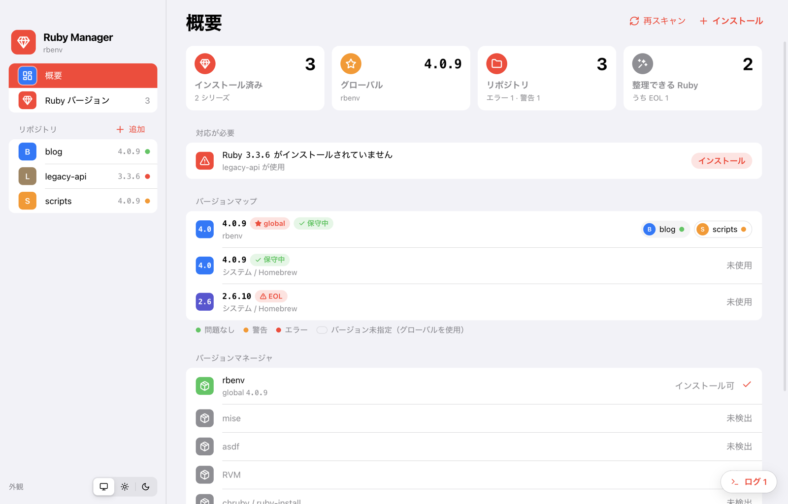
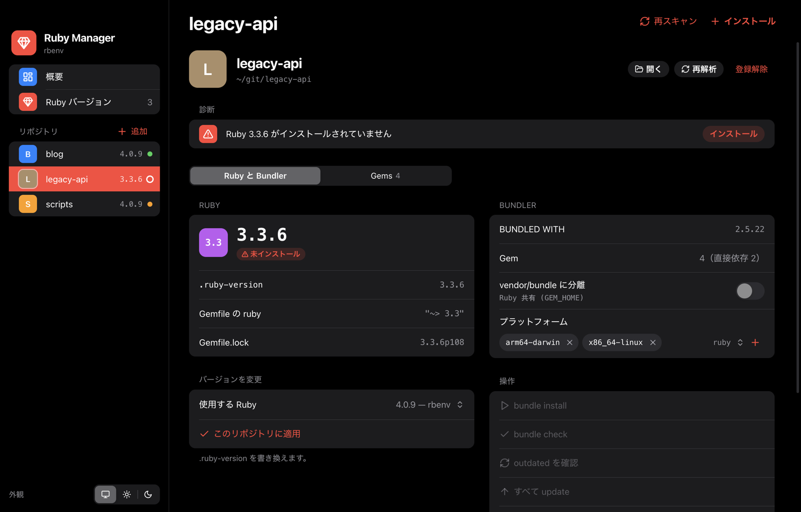
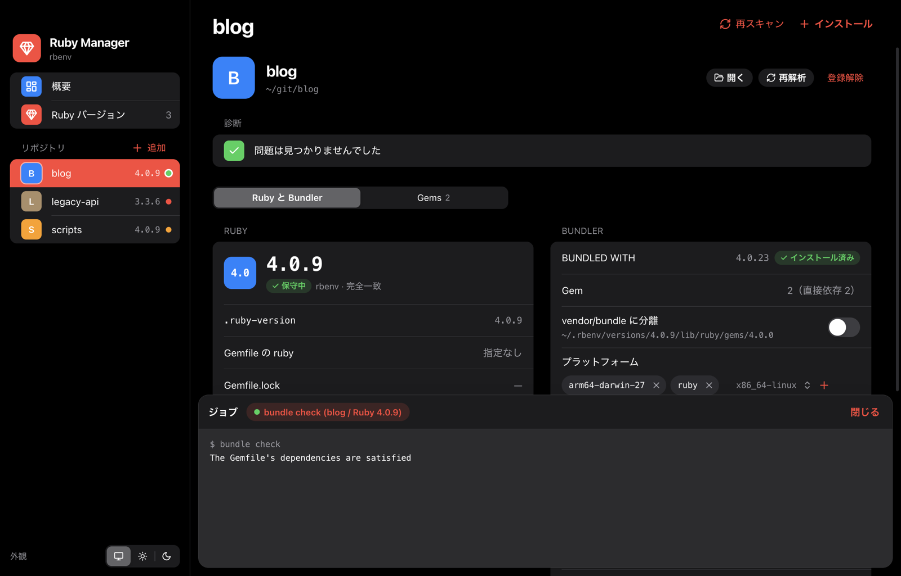
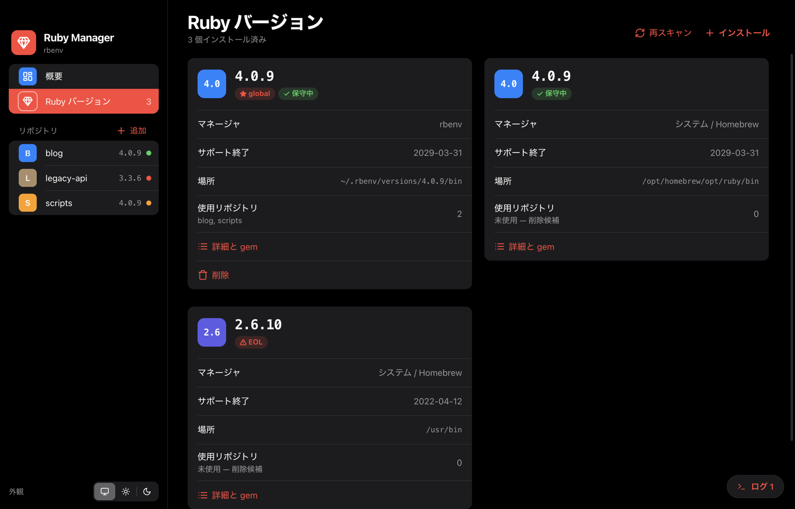
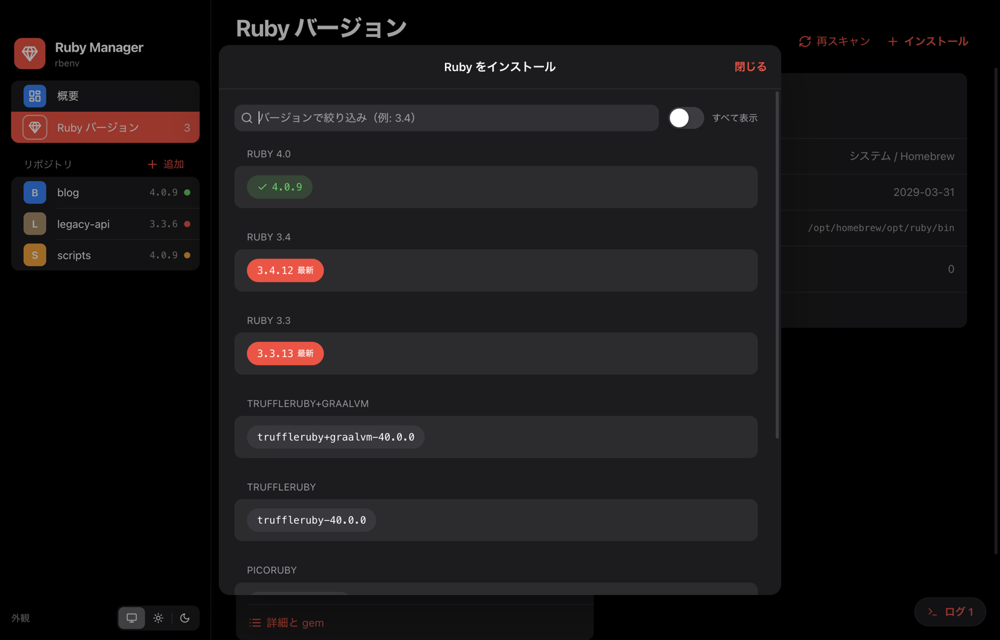

<div align="center">

# 💎 Ruby Manager

**Ruby のバージョンと、リポジトリごとの Bundler を「見て」管理するデスクトップアプリ**

[](https://github.com/eiei1000k/Ruby-Manager/releases/latest)
[](LICENSE)


[ダウンロード](#ダウンロード) · [はじめかた](#はじめかた) · [機能](#機能) · [対応環境](#対応しているバージョンマネージャ) · [トラブルシューティング](#トラブルシューティング) · [開発](#開発)

<picture>
  <source media="(prefers-color-scheme: dark)" srcset="docs/screenshots/overview.png">
  <source media="(prefers-color-scheme: light)" srcset="docs/screenshots/overview-light.png">
  
</picture>

</div>

---

「このリポジトリはどの Ruby だったっけ？」「この Ruby はまだ使ってる？」「`bundle install` が通らないのは Ruby が違うから？」——
**Ruby Manager** は、rbenv や mise などの既存のバージョンマネージャの上で動き、手元の Ruby とリポジトリの関係を 1 画面で見えるようにします。

- 普段使っているバージョンマネージャは**そのまま**。置き換えたり、独自の場所に Ruby を入れたりしません
- `.ruby-version` や `Gemfile.lock` を読むだけで、リポジトリの状態を診断します
- 操作はすべて、実際に実行されるコマンドとログを表示します
- iOS の設定アプリのような、見慣れたフラットデザイン。ライト / ダークの両方に対応しています

## ダウンロード

[**Releases ページ**](https://github.com/eiei1000k/Ruby-Manager/releases/latest)から、お使いの OS 向けのファイルをダウンロードしてください。

| OS | ファイル | 備考 |
|---|---|---|
| **macOS** | `.dmg`（または `.zip`） | Apple シリコン / Intel |
| **Windows** | `Setup .exe`（インストーラ）/ ポータブル版 `.exe` | Windows 10 / 11 |
| **Linux** | `.AppImage` / `.deb` | x64 |

> [!NOTE]
> 現在のリリースはコード署名をしていません。初回起動時に OS の警告が出る場合は、以下の手順で開いてください。
>
> - **macOS**: アプリを右クリック →「開く」。または「システム設定 → プライバシーとセキュリティ」で「このまま開く」。
>   それでも開けない場合: `xattr -dr com.apple.quarantine "/Applications/Ruby Manager.app"`
> - **Windows**: SmartScreen の画面で「詳細情報」→「実行」
> - **Linux (AppImage)**: `chmod +x Ruby*.AppImage` で実行権限を付けてから起動。起動しない場合は `libfuse2` を入れてください
> - **Linux (deb)**: `sudo apt install ./ruby-manager_*.deb`

### 必要なもの

Ruby Manager 自体は Ruby を必要としませんが、Ruby をインストールするには、次のどれかのバージョンマネージャが入っている必要があります。

- **macOS / Linux**: [rbenv](https://github.com/rbenv/rbenv) + [ruby-build](https://github.com/rbenv/ruby-build)、[mise](https://mise.jdx.dev/)、[asdf](https://asdf-vm.com/)、[RVM](https://rvm.io/)、[ruby-install](https://github.com/postmodern/ruby-install) のいずれか
- **Windows**: [mise](https://mise.jdx.dev/) または [winget](https://learn.microsoft.com/windows/package-manager/winget/)（[RubyInstaller](https://rubyinstaller.org/) を導入）

どれも入っていなくても、システムの Ruby の表示とリポジトリの診断は使えます。

## はじめかた

1. アプリを起動すると、インストール済みのバージョンマネージャと Ruby を自動で検出します
2. サイドバーの「リポジトリ」の **＋ 追加** を押して、リポジトリのフォルダを選びます。親フォルダ（例: `~/git`）を選ぶと、配下の Ruby リポジトリをまとめて登録します
3. **概要**画面で、どのリポジトリがどの Ruby を使っているか、対応が必要なものはないかを確認します

登録してもリポジトリのファイルは変更されません。ファイルを書き換えるのは、Ruby のバージョンを変更したときと、Bundler の操作を実行したときだけです。

## 機能

### 概要とバージョンマップ

画面上部のタイルに、インストール済みの Ruby の数、グローバルの Ruby、リポジトリの状態、整理できる（使われていない）Ruby の数をまとめて表示します。

その下の一覧で、インストール済みの Ruby ごとに、それを使っているリポジトリを並べて表示します。

- **対応が必要** — リポジトリが要求しているのに、まだインストールされていない Ruby。「インストール」ボタンからその場でインストールできます
- **未使用** — どのリポジトリも使っていない Ruby（削除候補）
- **保守中 / セキュリティ保守 / EOL** — 公式のサポート期間に基づくバッジ（緑 / オレンジ / 赤）
- **枠線だけのリポジトリ** — バージョン指定ファイルがなく、グローバル設定に頼っているリポジトリ
- リポジトリ名の横の点 — 🟢 問題なし / 🟠 警告 / 🔴 エラー

### リポジトリの診断と Ruby の切り替え



リポジトリを開くと、**診断**セクションに問題が一覧表示されます。必要な Ruby が入っていない場合は、その場の「インストール」ボタンで解決できます。

診断では、次のファイルを突き合わせて不整合を見つけます。

| 確認するもの | 例 |
|---|---|
| `.ruby-version` / `.tool-versions` / `mise.toml` | 指定された Ruby がインストールされているか、ファイル同士が食い違っていないか |
| Gemfile の `ruby "~> 3.3"` | 使用中の Ruby が要件を満たしているか |
| `Gemfile.lock` の `RUBY VERSION` | lock を作った Ruby とシリーズが違わないか |
| `Gemfile.lock` の有無 | `bundle install` をまだ実行していないか |

**バージョンを変更**セクションで使用する Ruby を選び、「このリポジトリに適用」を押すと、既存のバージョンファイルを書き換えます（なければ `.ruby-version` を作ります）。

### Bundler の管理



コマンドは常に**そのリポジトリが使う Ruby**で実行されるので、シェルでの Ruby の切り替えを気にする必要はありません。

- **操作**セクションから `bundle install` / `check` / `outdated` / `update` / `lock` / `clean` を実行し、画面下部のジョブパネルにログをリアルタイムで表示
- `Gemfile.lock` の `BUNDLED WITH` と同じバージョンの Bundler が入っているかを確認し、なければワンクリックでインストール
- 「vendor/bundle に分離」スイッチで、gem のインストール先をリポジトリ内に分けたり、Ruby 共有に戻したり
- lockfile のプラットフォーム（`x86_64-linux`、`arm64-darwin`、`x64-mingw-ucrt` など）を追加・削除。CI や Docker 用に Linux を足すときに便利です

**Gems タブ**では `Gemfile.lock` を解析して、gem の一覧を表示します。検索と「すべて / 直接依存」の切り替えで絞り込めます。「outdated を確認」を押すと、更新できるバージョンが各行に表示され、直接依存の gem はその場で `bundle update` できます。

### Ruby のインストール・削除・グローバル切り替え

<table>
<tr>
<td></td>
<td></td>
</tr>
</table>

- 右上の **＋ インストール** から、インストールできるバージョンをシリーズごとに表示します（赤 = 各シリーズの最新安定版、緑 ✓ = インストール済み）。「すべて表示」をオンにすると JRuby や TruffleRuby なども表示されます
- バージョンを押すとインストールを開始し、ビルドログを表示します
- **Ruby バージョン**画面では、Ruby ごとにマネージャ、サポート終了日、場所、使用しているリポジトリを表示します。「グローバルに設定」や「削除」もここから行えます
- 「詳細と gem」で、その Ruby の RubyGems と Bundler のバージョン、インストール済み gem の一覧を表示し、`gem install` もできます

### 外観とショートカット

サイドバー下部の「外観」で、**システム / ライト / ダーク**を切り替えられます（設定は保存されます）。

| 操作 | macOS | Windows / Linux |
|---|---|---|
| 再スキャン | `⌘R` | `Ctrl+R` |
| シートを閉じる | `Esc` | `Esc` |

## 対応しているバージョンマネージャ

| マネージャ | macOS | Linux | Windows | 一覧 | インストール / 削除 | グローバル切替 |
|---|:-:|:-:|:-:|:-:|:-:|:-:|
| rbenv + ruby-build | ✓ | ✓ | – | ✓ | ✓ | ✓ |
| mise | ✓ | ✓ | ✓ | ✓ | ✓ | ✓ |
| asdf | ✓ | ✓ | – | ✓ | ✓ | ✓ |
| RVM | ✓ | ✓ | – | ✓ | ✓ | ✓ |
| chruby + ruby-install | ✓ | ✓ | – | ✓ | ✓ | `~/.ruby-version` |
| RubyInstaller（winget） | – | – | ✓ | ✓ | ✓（シリーズ単位） | – |
| システム / Homebrew の Ruby | ✓ | ✓ | – | ✓ | – | – |

複数のマネージャが同時に入っていても、すべての Ruby をまとめて表示します。

## トラブルシューティング

<details>
<summary><b>バージョンマネージャが検出されない</b></summary>

macOS / Linux では、起動時にログインシェル（`$SHELL -il`）から環境変数を読み込みます。`rbenv init` や `mise activate` を `.zshrc` / `.bashrc` / `.bash_profile` に書いているか確認し、右上の「再スキャン」（`⌘R` / `Ctrl+R`）を押してください。
Windows では、マネージャのコマンドが PATH に入っている必要があります。インストール直後はアプリを再起動してください。
</details>

<details>
<summary><b>インストールできるバージョンの一覧が古い・空になる</b></summary>

一覧は各マネージャから取得しています。ビルド定義を更新してください。

- rbenv: `brew upgrade ruby-build` または `git -C "$(rbenv root)"/plugins/ruby-build pull`
- asdf: `asdf plugin update ruby`
- RVM: `rvm get stable`
</details>

<details>
<summary><b>Ruby のビルドに失敗する</b></summary>

ログに表示されたエラーを確認してください。多くの場合、ビルドに必要なライブラリ（OpenSSL、libyaml、readline など）が不足しています。各マネージャのドキュメント（例: [ruby-build の推奨ビルド環境](https://github.com/rbenv/ruby-build/wiki#suggested-build-environment)）を参照してください。
</details>

<details>
<summary><b>登録したリポジトリの一覧はどこに保存される？</b></summary>

`projects.json` に保存されます。消すと登録がリセットされます。

- macOS: `~/Library/Application Support/Ruby Manager/`
- Windows: `%APPDATA%\Ruby Manager\`
- Linux: `~/.config/Ruby Manager/`
</details>

## プライバシー

Ruby Manager は利用状況やデータを外部に送信しません。ネットワークにアクセスするのは、あなたが実行した操作（Ruby のインストール、インストールできるバージョンの取得、`bundle install` / `outdated` など）が呼び出すコマンドだけです。

## 開発

Node.js 20 以上が必要です。

```sh
git clone https://github.com/eiei1000k/Ruby-Manager.git
cd Ruby-Manager
npm install
npm start      # アプリを起動
npm test       # Gemfile.lock パーサとバージョン判定のテスト
```

### パッケージのビルド

```sh
npm run dist:mac     # .dmg / .zip
npm run dist:win     # NSIS インストーラ / ポータブル .exe
npm run dist:linux   # AppImage / .deb
```

成果物は `dist/` に出力されます。各 OS 向けのパッケージは、その OS 上でビルドしてください。

### ディレクトリ構成

```
src/
├── main/
│   ├── main.js       Electron メインプロセス、IPC、ジョブ（コマンド）の実行
│   ├── managers.js   バージョンマネージャごとのアダプタ
│   ├── project.js    リポジトリの解析（バージョンファイル・Gemfile・.bundle/config）
│   ├── lockfile.js   Gemfile.lock と bundle outdated の出力のパーサ
│   ├── versions.js   バージョン比較・要件判定・サポート期間（EOL）の表
│   └── exec.js       コマンド実行、ログインシェルの環境変数の取得
├── preload.js        レンダラーに公開する API
└── renderer/         UI（HTML / CSS / JavaScript、フレームワークなし。iOS 風のデザイン）
test/                 node:test によるテスト
```

新しいバージョンマネージャに対応するには、`src/main/managers.js` にアダプタ（`detect` / `list` / `getGlobal` / `setGlobal` / `listRemote` / `installCmd` / `uninstallCmd` / `execCmd`）を追加して、`ALL` に登録します。

Ruby のサポート期間は `src/main/versions.js` の `EOL` 表で管理しています。新しいブランチが出たら、[公式のブランチ保守状況](https://www.ruby-lang.org/ja/downloads/branches/)に合わせて更新してください。

## コントリビュート

Issue や Pull Request を歓迎します。Pull Request を送る前に `npm test` が通ることを確認してください。UI を変更した場合は、ライト / ダーク両方のスクリーンショットを添えてもらえると助かります。

## ライセンス

[MIT](LICENSE) © eiei1000k
